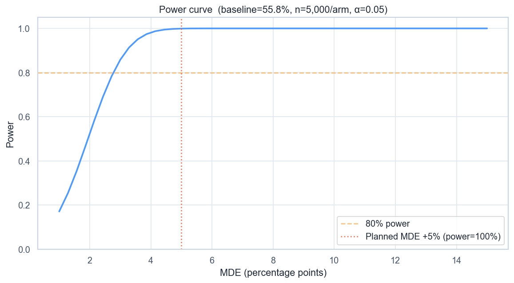

# Volta — KYC Progress-Bar A/B Test

[](https://github.com/NikitaBoyarkin/case-ab/actions/workflows/ci.yml)

[](LICENSE)

A KYC progress bar lifted conversion +5.72pp (Z=5.82, p<0.0001) against a +5pp MDE. CUPED, AA-test and Bonferroni protect the conclusion; +€656K/yr at 44× ROI.

## Key results

- +5.72pp KYC conversion (Z=5.82, p<0.0001), above MDE
- Ship-gate: significance ∧ lift≥MDE ∧ no SRM → ship
- +€656K/yr at 44× ROI on €15K dev-cost

## Situation

Validating the funnel finding: a snapshot is not proof, so the hypothesis (split KYC into steps with a progress bar) was tested as an experiment.

## Task

I needed to show that the onboarding snapshot held up under a controlled test, so I owned the experiment that split KYC into steps with a progress bar.

## Actions

- Sample-size calculation for the MDE, SRM check (p=1.00), bootstrap CI.
- **CUPED** with 'sessions before the test' as covariate (control-only θ).
- **AA-test** under H₀ (type-I = 0.050) and multiple-comparison correction (Bonferroni/Holm/BH).
- Sensitivity at the MDE (not post-hoc power).

## Result

- Control **55.8%** → treatment **61.5%**: **+5.72pp**, 95% CI [+3.78%, +7.66%], p<0.0001 — above the +5pp MDE.
- No SRM; covariate balance confirmed.
- 6/11 segments naively significant, 4/11 after Bonferroni.
- Ship-gate passed → roll the progress bar out to 100%; business impact **+€656K/yr**.

## Recommendations

- Ship the progress bar to 100% — the gate is passed.
- Keep the three-condition ship-gate: it protects against statistically-significant but business-insignificant changes.
- Re-test the segment effects individually after Bonferroni.

## Charts


> # KYC Progress Bar A/B Test — Conversion Comparison
>
> 
>
> *Конверсия KYC start → complete по веткам эксперимента с 95%-ми доверительными интервалами.*
>
> ## Выводы
>
> - Treatment: 61.54% против Control: 55.82% (лифт +5.72%).
> - 95%-й ДИ лифта: [+3.78%, +7.66%].
> - Результат статистически значим (Z=5.82, p=0.0000).
> - Гейт выката пройден: p=0.0000 (<0.05), лифт +5.72% ≥ +5% MDE, SRM p=1.0000 (≥0.01) → раскатка на 100%.
>
> ---
> <sub>Источник: `scripts/volta_ab_testing.py` · данные: `data/volta_ab_experiment.csv`</sub>



## Dataset

The dataset is fully synthetic, generated by seeded, reproducible script(s) (`scripts/generate_ab_data.py`). No real customer data is used. Running `make data` regenerates the CSV(s) in `data/` with the same random seed, so every number below is reproducible.

## Quick start

```bash
uv sync --all-groups
make data
make run
```

## Project structure

```text
case-ab/
├── README.md
├── LICENSE
├── .gitignore
├── .python-version
├── pyproject.toml
├── Makefile
├── .github/workflows/ci.yml
├── scripts/
│   ├── generate_ab_data.py
│   └── volta_ab_testing.py
├── utils/
│   ├── __init__.py
│   ├── common.py
│   └── viz_helpers.py
├── data/
│   └── volta_ab_experiment.csv
│   └── segment_results.csv
├── outputs/
│   ├── ab_conversion_comparison.png
│   ├── ab_power_curve.png
└── tests/
    └── test_ab.py
```

## Stack

- Python
- pandas / NumPy
- SciPy / Statsmodels
- scikit-learn
- Matplotlib / Seaborn
- uv + ruff

## Links

- [Full case study on the portfolio site](https://nikitaboyarkin.github.io/en/projects/volta/ab/)
- [Parent project — volta-banking](https://github.com/NikitaBoyarkin/volta-banking)
